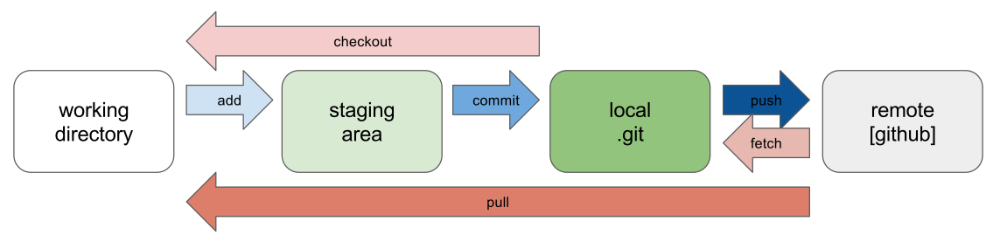

# Introduction to Git

## What is Git?

Git is a free and open-source distributed version control system designed to handle projects with speed and efficiency.

Real-life projects generally have multiple developers working in parallel, and the code in Git keeps changing as more code is added by developers. Git helps us with the following features:

- Maintain history of what changes have happened
- Ensure no conflicts between developer's codes
- Revert or go back to previous versions

## Git Terminologies

### Repository

A repository is similar to how you store files in a folder or directory on your computer. In Git, files are stored in a repository. A **remote repository** refers to the files on GitHub/GitLab, and a **local copy** refers to the files on your computer.

### Branch

In Git, a branch is a pointer to a specific commit. It can be considered as an independent line of development to isolate our work from other team member's work.

### Fork

Fork is nothing but a copy of a project present in Git. When we want to contribute to someone else's project, we make a copy of it in our own namespace.

### Clone

Cloning/downloading is the process of creating a copy of a remote repository's files on our computer.

The only difference between download and clone is that if you download a repository you cannot sync the repository with the remote repository on Git.

But if you clone, it preserves the git connection and you can upload the changes in the local file to the remote repository.

### Push

After changes are made to the local copy of a repository, you can upload the changes to the remote repository using the **push** feature.

### Pull

When the remote repository changes, your local copy is left behind. You can update your local copy with the new changes in the remote repository using the **pull** feature.

## General Git Flow



1. Initially we create a local copy of the remote repository using `git clone`/`git pull` to get the latest updates made to the repository.

2. Once we make changes to the local copy, we need to add the modified files to the staging area using `git add` so that Git tracks the changes made to the files.

3. Then we **commit** the changes to the local Git repository. Each commit in Git records a snapshot of the state of the full repository along with the name, timestamp, and message of the committer.

4. The changes committed in the local repository can be sent to the remote repository with the `git push` command. This command pushes all the committed changes to the remote repository.

## Workflow Diagram

```
Remote Repository (GitHub)
    ↓ git clone
Local Repository
    ↓ git add
Staging Area
    ↓ git commit
Local Repository
    ↓ git push
Remote Repository (GitHub)
```

## Key Commands Overview

| Command | Purpose |
|---------|---------|
| `git clone` | Create local copy from remote |
| `git add` | Stage changes for commit |
| `git commit` | Save staged changes to local repo |
| `git push` | Send commits to remote repo |
| `git pull` | Update local from remote repo |
| `git status` | Show working tree status |
| `git branch` | List/create branches |
| `git checkout` | Switch branches |
| `git merge` | Join branch histories |

Git is a free, open-source software tool that tracks changes in code files locally on a computer, while GitHub is a cloud-based hosting service owned by Microsoft that allows developers to store, manage, and collaborate on those Git projects online